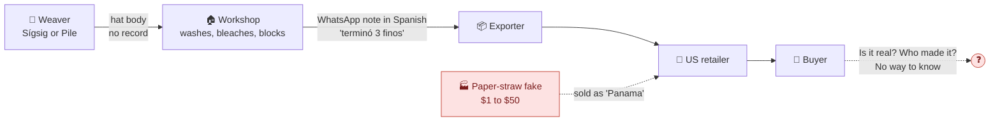
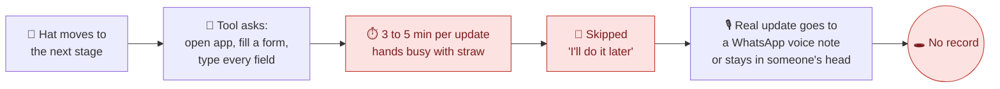
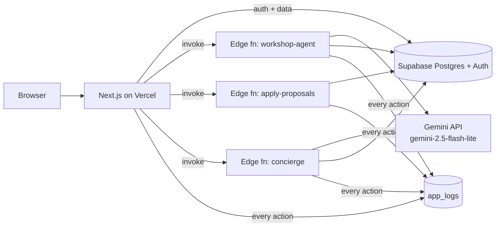

# Toquilla Trace

> An AI agent that turns messy workshop notes into verified digital passports for genuine Ecuadorian "Panama" hats. The AI proposes, a human approves, and the code enforces the rules.

| | |
|---|---|
| **Status** | Built and deployed. See [Status](#12-status) and [HANDOFF.md](HANDOFF.md) for what works and what is incomplete. |
| **Live link** | https://toquilla-trace.vercel.app · try [a hat passport](https://toquilla-trace.vercel.app/hat/TQ-9A1M8) (no login) · [docs](https://toquilla-trace.vercel.app/docs) |
| **Stack** | TypeScript · Next.js on Vercel · Supabase (Auth, Postgres, Edge Functions) · Google Gemini 2.5 Flash-Lite (`gemini-2.5-flash-lite`) |
| **Platform** | Responsive web app: mobile-first for workshops and buyers, desktop-first for builder screens (Agent runs, Logs) |
| **Timebox** | 2 hours of build time |

---

## For reviewers (start here)

| | |
|---|---|
| **Live app** | https://toquilla-trace.vercel.app (public passport without login: [TQ-9A1M8](https://toquilla-trace.vercel.app/hat/TQ-9A1M8)) |
| **Demo accounts** | `member@test.com` (workshop member, Taller Pillco: the AI agent), `admin@test.com` (admin: Agent runs and Logs), `buyer@test.com` (can claim `TQ-9A1M8`). **Password: in the submission note.** |
| **Demo-only access** | These are **shared demo accounts with a weak, demo-only password, by design**, so reviewers can get in fast. Production would not work like this: a unique strong admin password, MFA, no shared accounts, admins provisioned out of band, and an 8+ character minimum enforced server-side. Details in [SECURITY.md](docs/SECURITY.md). |

**3-minute tour**
1. Log in as `member@test.com`, open **Workshop**, tap the mic (Chrome or Edge) or type: _"Doña Rosa terminó 3 finos de 18 hileras. El TQ-7F3K2 pasa a blanqueo."_ The agent looks things up and returns proposal cards (two weavers are named Rosa, so it asks which one).
2. **Approve** a card (10 s undo), then open the hat in **Hats**: the stage and timeline changed, and the rules were re-checked in code on approval.
3. Open a **passport** ([TQ-9A1M8](https://toquilla-trace.vercel.app/hat/TQ-9A1M8)) logged out: Verified certificate, weaver credit, timeline.
4. **Ask the concierge** on that page "Is this hat real?" or "Who wove it?". Try "mark it as Finished" or an injection: it refuses.
5. Log in as `admin@test.com`, open **Agent runs** (every model call, tool call and rule check of step 1) and **Logs** ("Copy as prompt for an AI assistant").

**Code map: the 8 files to read first**

| File | What it does |
|---|---|
| [workshop-agent/index.ts](supabase/functions/workshop-agent/index.ts) | Edge Function entry: auth, input checks, 20 runs/hour limit, runs the loop, saves the run and its proposals |
| [_shared/agent.ts](supabase/functions/_shared/agent.ts) | System prompt and the manual Gemini tool loop: caps, finish reasons, summary checked in code |
| [_shared/tools.ts](supabase/functions/_shared/tools.ts) and [_shared/tools/propose.ts](supabase/functions/_shared/tools/propose.ts) | Tool declarations; read tools query the workshop, propose tools check the quote, grounding and rules, then only buffer a proposal |
| [_shared/domain.ts](supabase/functions/_shared/domain.ts) | Every business rule as pure functions with zero imports: stage machine, grade vs rows, codes, anomalies |
| [_shared/apply.ts](supabase/functions/_shared/apply.ts) (called by [apply-proposals/index.ts](supabase/functions/apply-proposals/index.ts)) | Approval path: re-checks every rule on fresh rows, then writes through the `apply_proposal` SQL function |
| [migrations/..._rls.sql](supabase/migrations/20261019000002_rls.sql) | Row-level security and column grants on all 9 tables (tightened later by `..._definer_hat_writes.sql` and `..._hat_grants_contact_email.sql`) |
| [components/workshop/useProposals.ts](components/workshop/useProposals.ts) | Proposal cards in the browser: approve, edit, reject, 10 s undo queue, results per card |
| [concierge/index.ts](supabase/functions/concierge/index.ts) | Public concierge: rate limits, loads the public record in code, one model call with no tools, answer checked in code |

**Docs:** [SECURITY](docs/SECURITY.md) · [ARCHITECTURE](docs/ARCHITECTURE.md) · [AI](docs/AI.md) · [ENGINEERING](docs/ENGINEERING.md) · [EVALS](docs/EVALS.md) · [HANDOFF](HANDOFF.md) · reading guide in [docs/README.md](docs/README.md) · all of them in the app at [/docs](https://toquilla-trace.vercel.app/docs).

---

## TL;DR

- **Problem:** fake "Panama hats" (paper straw) are sold as Ecuadorian, and weavers get no credit. Tools fail because typing takes too long, so workshops just send quick voice notes in Spanish.
- **Product:** you just **say** the update, an agent turns it into proposed record changes, and a person approves them. Every hat gets a public passport buyers can verify and ask questions about.
- **Why it's interesting:** it shows how to deploy AI safely into a messy real business: human approval, rules in code, least privilege, full traces and evals.

---

## 1. The problem

A real "Panama hat" is hand-woven in Ecuador and can take weeks or months to make. On its way to a buyer it passes through several hands, and **no record travels with it**.



**Why tracking tools don't fix it:** every tool asks people to stop working and type. Their hands are full of straw, so they skip it, and the data never gets in.



> **Key insight:** the problem isn't a missing tool. It's that **writing things down takes too long.** People already *tell* updates (voice notes, chats), so the system should listen.

**Where it breaks:**

| # | Pain point | Who it hurts |
|---|---|---|
| 1 | **Writing takes too long.** Forms and typing cost minutes per update with busy hands, so updates get skipped | Every tool that depends on data entry fails |
| 2 | Production data lives in **voice notes, chats and memory**, not in a system | Workshops lose track of hats and stages |
| 3 | **Fakes look the same** to a buyer and are sold under the same name | Buyers overpay; honest sellers lose trust |
| 4 | **Weavers are invisible.** Their name never reaches the buyer (in 2017 they earned $2.50 to $6 per hat, [The World](https://theworld.org/stories/2017/03/10/panama-hats-made-ecuador)) | Weavers get no credit or premium |
| 5 | Grades (Fino, Superfino) are **claimed, not checked** | Buyers can't tell if the price is fair |

**Why now:** in August 2026, Montecristi launched QR certificates for authentic hats, but only 2 hats had been certified ([El Universo, 2026-09-09](https://www.eluniverso.com/noticias/ecuador/sombrero-montecristi-28-pasos-qr-y-tecnologia-para-evitar-falsificaciones-nota/)). Demand for proof exists; the tooling doesn't.

**Why I care:** I live in Ecuador, and I researched this trade before the take-home: about 2,500 weavers ([Vistazo 2021, citing PRO ECUADOR](https://www.vistazo.com/enfoque/sombrero-de-paja-toquilla-ecuatoriano-busca-destacarse-en-nuevos-mercados-MGVI222196)), exporters in Cuenca, widespread fakes, and a craft on the [UNESCO intangible heritage list since 2012](https://ich.unesco.org/en/RL/weaving-of-traditional-toquilla-straw-hats-of-ecuador-00729).

---

## 2. The solution

**Just tell it.** Keep the workshop's habit (**a quick voice note**, like on WhatsApp) and let an AI agent do the paperwork, with a human approving every change and the code enforcing the rules. Each hat gets a passport the buyer can check.

```mermaid
flowchart LR
  N["🎙️ Workshop says it<br/>'Doña Rosa terminó 3 finos,<br/>18 hileras'<br/>about 10 seconds"] --> T["📝 Live transcript<br/>speech to text"]
  T --> TC{"👤 Transcript<br/>looks right?"}
  TC -->|"fix a word / re-record"| T
  TC -->|"send"| A["🤖 Agent<br/>reads and looks up<br/>weavers and hats"]
  A --> P["📋 Proposals<br/>create 3 hats · Fino · Rosa"]
  P --> H{"👤 Human<br/>approves?"}
  H -->|"edit / reject"| P
  H -->|"approve"| V["🔒 Rule check in code<br/>stage order · grade vs weave"]
  V -->|"blocked: explains why"| P
  V -->|"allowed"| D[("Database<br/>hat + append-only history")]
  D --> Q["🪪 Public passport<br/>/hat/TQ-7F3K2"]
  Q --> B["🧑 Buyer sees Verified,<br/>weaver, timeline"]
  B --> C["💬 Read-only concierge<br/>answers from the record"]
  A & V & D & C -.-> L[("📊 app_logs<br/>every step")]

  classDef ai fill:#e8f0fe,stroke:#3b5bdb,color:#1b2a6b;
  classDef human fill:#e6f4ea,stroke:#2f9e44,color:#14532d;
  classDef rule fill:#fff4e5,stroke:#e8590c,color:#7c2d12;
  class A,P,C,T ai;
  class H,TC human;
  class V rule;
```



**Before vs after:**

| | Today | With Toquilla Trace |
|---|---|---|
| Time per update | 3 to 5 min of typing (our estimate), so it's skipped | About 10 seconds of talking, plus one tap to approve |
| Recording production | Voice notes, chats, memory | Same quick voice note, turned into records by the agent |
| Data entry effort | Forms nobody fills | Zero forms: talk, check the transcript, approve |
| Correctness | Whatever someone typed | Rules in code: no skipped stages, grade must match weave count |
| Weaver credit | Lost | Name and village on every passport |
| Buyer trust | "Trust me" | Verified passport plus a timeline |
| Buyer questions | Ask the seller | Concierge that answers only from the record |
| When something fails | Nobody knows | Every step in `app_logs`, debuggable by a human or an AI |

**Why AI is the right tool here (and where it isn't):**
- ✅ **AI:** understanding messy spoken or written Spanish, matching "Doña Rosa" to the right weaver, answering buyer questions in natural language.
- ❌ **Not AI:** stage order, grade ranges, permissions and size conversion. These are plain code with tests, so the model can't break them.

---

## 3. What the app does

| Feature | Who | What happens |
|---|---|---|
| **Workshop agent** | Logged-in workshop | Speak or type a note like _"Doña Rosa terminó 3 finos, 18 hileras, mañana van a blanqueo"_. The agent proposes actions (create hats, advance stage, flag issues). You approve, edit or reject each one. |
| **Public passport** | Anyone | `/hat/TQ-9A1M8` shows a Verified or Not verified certificate, weaver, timeline and specs. |
| **Buyer concierge** | Anyone | A read-only chat on the passport page that answers only from the hat's record. |
| **Agent runs** | Admin only | A step-by-step trace of every agent run: model calls, tool calls, rule checks, human decisions. |
| **System log** | Admin only | Every action in the app, in one table, so a human or an AI assistant can debug from it. |

**Domain rules (enforced in code):**
- Stages only move forward, one at a time: Weaving → Washing → Bleaching → Blocking → Finished.
- Grade must match weave count: Standard 8 to 14, Fino 15 to 24, Superfino 25+ rows per inch.
- Only the current owner can advance or transfer a hat.

---

## 4. AI-native principles we followed

| # | Principle | How it shows up |
|---|---|---|
| 1 | **AI proposes, humans approve** | Write tools never execute during the agent run. They return proposals. Nothing is saved without a click. |
| 2 | **Rules live in code, not prompts** | The stage machine and grade checks are plain TypeScript functions with tests. If the model is wrong, the tool rejects it and tells the model why. |
| 3 | **Least privilege** | The public concierge has no tools at all: the hat's public record is loaded in code before the model call, so it can't change data even if a user (or injected text) asks. People too: workshop members never see logs, traces or costs; only admins do, enforced by the database. |
| 4 | **Untrusted input is data** | Notes, chat messages and hat records are never treated as instructions. The same rule is in `CLAUDE.md` for the coding assistant. |
| 5 | **Observe everything** | Every request, tool call, rule check and decision goes to the `app_logs` table with a request ID. |
| 6 | **Measure, don't guess** | A small eval set (tricky notes with expected tool calls) runs with `npm run eval`; results in [EVALS.md](docs/EVALS.md). |
| 7 | **Don't use an LLM when code works** | Size conversion, grade ranges and stage order are code. The model handles language, not math. |
| 8 | **Cost and latency are features** | Each run records tokens, latency and cost, shown in the UI. |
| 9 | **Small, verified steps** | Tests ship with behavior, and hooks block skipped tests and silenced type errors. |

---

## 5. Architecture



| Piece | Job |
|---|---|
| **Next.js (Vercel)** | UI, login, reading data through Supabase with row-level security. |
| **Roles** | `profiles.role` is `member` (workshop staff, own workshop only) or `admin` (Toquilla Trace staff, everything including `app_logs`). Enforced with row-level security, not just hidden links. |
| **`workshop-agent`** | Runs the tool-use loop. Read tools execute; write tools become rows in the `proposals` table, linked to the run's trace in `agent_runs`. |
| **`apply-proposals`** | Takes the approved proposals, re-validates every rule, and writes to the database. |
| **`concierge`** | Q&A for one hat from its public record. No tools, no writes. |
| **Shared domain code** | `stage machine`, `grade rules`, `tool validation`. Pure TypeScript, used by the functions and tested with Vitest. |

**Data model (9 tables):** `workshops`, `profiles`, `weavers`, `hats`, `hat_events` (append-only history), `hat_flags` (anomalies), `agent_runs` (run traces), `proposals` (AI proposals and human decisions), `app_logs`. Diagram in [ARCHITECTURE.md](docs/ARCHITECTURE.md#3-data-model).

---

## 6. Logging, so any bug can be fixed from one table

Every action writes one row to `app_logs`.

| Column | Example |
|---|---|
| `created_at` | `2026-10-18 10:42:13.512` |
| `level` | `info` / `warn` / `error` |
| `source` | `web`, `edge:workshop-agent`, `edge:apply-proposals`, `edge:concierge`, `db` |
| `action` | `agent.tool.call`, `proposal.approve`, `hat.stage.advance` |
| `request_id` | ties together every row from one user action |
| `user_id`, `hat_code`, `run_id` | context |
| `payload` (jsonb) | inputs, outputs, tool arguments |
| `error`, `duration_ms` | failures and timing |

**Debug workflow:** an error appears in the Logs screen → filter by `request_id` → open the run trace → click **"Copy as prompt for an AI assistant"** → paste into Claude Code, which reads the payload, finds the bug and proposes a fix with a test.

Secrets and passwords are never logged. Only admins can read `app_logs` (row-level security), because it holds data from every workshop.

---

## 7. Decision log

| Decision | Why | Rejected alternative |
|---|---|---|
| Hat provenance as the topic | Real problem I know, needs AI for messy Spanish input | Generic recipe or music app (common, no reason for AI) |
| Agent with tools, not a single prompt | The task needs lookups (weavers, hats) and checks before acting | One big prompt that outputs JSON (no validation, no recovery) |
| Human approval for writes | Writes are costly to undo; reads are not | Fully autonomous agent (risky, hard to trust) |
| Voice first, with an editable transcript | Workshops already use WhatsApp voice notes. The transcript is shown before sending so speech-to-text mistakes are caught by a person | Typing only (slow on a phone) or auto-sending audio (errors reach the agent unseen) |
| Browser speech recognition (Web Speech API, es-EC) | Free, no extra vendor, live transcript, fits the timebox | A paid speech-to-text API (better accuracy, planned as a next step) |
| Rules in tools | The model can be wrong; the database can't be | Prompt instructions like "never skip stages" |
| Read-only public agent | Public input is untrusted; blocks prompt injection by design | One agent with all tools |
| Supabase (Auth + Postgres + Edge Functions) | Login, database and server functions in one free service; relational data fits hats, history and logs; roles enforced with row-level security; plain SQL for debugging logs | Firebase (NoSQL makes log queries awkward, roles need custom claims, Cloud Functions need the paid plan) or custom auth (too slow for 2 hours) |
| Two roles: member and admin | Logs and traces hold every workshop's data; staff on a phone don't need JSON or costs | Everyone sees everything (a privacy leak and a cluttered mobile app) |
| Gemini 2.5 Flash-Lite for both agents (D26) | Fast and very cheap (about $0.001 per workshop run), good enough for short tool loops when the rules live in code; one adapter file (`_shared/llm.ts`) and an env var switch models | A larger model (better multi-step tool use, 10 to 50 times the cost per run); the guardrails and the eval set cover the gap |
| Vercel for Next.js | Deploy in minutes, preview links | Self-hosting |
| `app_logs` table | One place to debug, readable by humans and AI | Console logs only (lost after deploy) |
| Design with Claude Design from a detailed prompt, then own it | Every screen and state is specified before coding. After reviewing the rendered prototypes, revisions are made by hand | Designing while coding, or trusting generated mockups without checking them |
| Full design, partial build | Shows product vision and prioritization at the same time | Building everything badly |

---

## 8. How we worked (AI-native workflow)

1. **Research first.** Used Claude Code with parallel research agents to study the toquilla hat market, competitors and logistics. This is where the topic and the real problem came from.
2. **Pick a problem that needs AI.** First idea was a provenance tracker. Feedback: "Casper deploys AI, this has no agentic approach." We redesigned it around an agent with tools and human approval.
3. **Spec before code.** Wrote a complete design prompt ([docs/design-prompt.md](docs/design-prompt.md)) covering every screen, button, state and copy, and gave it to Claude Design.
4. **Review the AI's output, don't trust it.** Rendered the prototypes and clicked through them. Found that workshop staff could see logs, sample data that contradicted our own rules (a hat moving backward, a Superfino woven in 23 days), AI proposals that the note didn't support, and a runtime bug. Fixed them by hand and documented them in [design_handoff_toquilla_trace/README.md](design_handoff_toquilla_trace/README.md) (revision 2).
5. **Guardrails for the coding assistant.** The repo starts from a hardened Claude Code setup ([docs/boilerplate.md](docs/boilerplate.md)):
   - `CLAUDE.md`: golden rules, tests as a contract, untrusted-content rule
   - hooks: block dangerous commands, block skipped tests and silenced type errors, auto-format
   - pre-commit: typecheck, lint and unit tests; CI: the same plus `next build`, `deno check` and `deno lint`
6. **Parallel agents, one coordinator.** During the build, Claude Code agents worked in parallel, each owning a set of files (foundation, database, Edge Functions, workshop UI, public UI, hats and admin, docs). I coordinated them, reviewed and integrated their work, and ran it against the real project. That is why the first commits are large: parallel work landed in a few integration commits, followed by small fix commits.
7. **Review, then verify.** Independent review agents then audited compliance, security, AI, code, docs and UX, and their findings were fixed in follow-up commits. The core path (code map above) is the part to walk through line by line; walkthrough notes are in the docs.

---

## 9. Build timeline (planned vs actual)

| | Plan ([spec 10](docs/specs/10-quality-evals-and-delivery.md)) | What actually happened (`git log`) |
|---|---|---|
| Before the timer | Research, problem choice, design prompt and prototypes, 10 specs with one decision log | Done as planned; not counted in the 2 hours |
| Build | Vertical slices, each deployed before the next | Parallel agents per area. Commits: scaffold (20:01), database (20:18), all features in one integration commit (20:27), then about 30 small fix and docs commits until 21:12 |
| After the build | (not planned) | Independent review agents (compliance, security, AI, code, docs, UX) and a fix pass: password reset, eval reset, a live security check script, stricter hat grants, docs cleanup |

**Cut on purpose (next steps):** server-side speech-to-text for browsers without voice support, photos, QR images, ownership transfer emails, weaver management UI polish, payments, multiple workshops.

---

## 10. Repository layout

```
app/                    Next.js routes: workshop, hats, weavers, runs, logs, settings (signed in);
                        /, /login, /signup, /forgot, /reset, /auth/confirm, /hat/[code], /docs (public)
components/             UI kit, shell, feature components
lib/                    Supabase clients, logger, auth, docs registry, security headers
supabase/
  migrations/           SQL schema, row-level security, functions, demo seed, fixes
  functions/
    _shared/            domain rules, tools (+ tools/), agent loop, apply checks, Gemini adapter, logger (pure TS, tested)
    workshop-agent/     agent loop (proposals only)
    apply-proposals/    validates and writes approved actions
    concierge/          public Q&A, no tools
scripts/                seed-users.mjs, eval-reset.mjs, verify-security.mjs, logs.ts (npm run ...)
evals/                  agent eval cases, runner and latest results
tests/                  Vitest (domain rules, tools, loop, UI logic, docs, headers)
docs/                   architecture, AI, security, engineering, evals, specs (also at /docs)
design_handoff_toquilla_trace/  clickable HTML prototypes + design spec (source of truth for UI)
```

---

## 11. Run it locally

Runs the web app locally against the hosted Supabase project (no local database needed):

```bash
npm install
cp .env.example .env          # the project URL is already filled in; paste the anon key from the submission note
npm run dev                   # http://localhost:3000, log in with the demo accounts
npm test                      # unit tests, no network
```

Everything below is optional and needs project access (service role key in `.env`, the DB password in `.db-password`, the Supabase CLI via npx):

```bash
npx --yes supabase@2.121.0 link --project-ref xzimmdrjvcswlxievxhr -p "$(< .db-password)"
npx --yes supabase@2.121.0 db push -p "$(< .db-password)"        # migrations
npm run seed:users                                                # demo + eval accounts (confirmed)
npx --yes supabase@2.121.0 functions deploy workshop-agent apply-proposals concierge \
  --project-ref xzimmdrjvcswlxievxhr --use-api                    # Edge Functions
npx --yes supabase@2.121.0 secrets set GEMINI_API_KEY=...          # model key lives only here, never in .env or Vercel
```

Debugging and evals:

```bash
npm run logs -- --level error --since 1h     # app_logs from the terminal (service role, local only)
npm run logs -- --request req_8f2a91c4e2b7   # everything for one request
npm run eval:reset                           # put the Eval Workshop back to its seeded state
npm run eval                                 # agent eval cases against the deployed functions (results: docs/EVALS.md)
npm run verify:security                      # live RLS, grant and claim-flow checks (scripts/verify-security.mjs)
```

Demo accounts: see [For reviewers](#for-reviewers-start-here).

---

## 12. Status

| Area | Status |
|---|---|
| Research, problem choice, agentic redesign, design spec, prototype review (revision 2) | Done (before the build timer) |
| Auth with email confirmation and password reset, two roles enforced by RLS | Done |
| Composer: typed and voice (Chrome/Edge, es-EC and en-US), editable transcript | Done |
| Workshop agent (Gemini tool loop, rules in code) and proposal review with rule re-check | Done |
| Hats list and detail (advance, flags, transfer, archive), weavers | Done |
| Public passport, claim flow, read-only concierge | Done |
| Logs (admin), agent runs and traces, `npm run logs` | Done |
| Security hardening (definer write RPCs, no direct hat updates, security headers, log PII stripping, `npm run verify:security`) | Done, see [docs/SECURITY.md](docs/SECURITY.md) |
| In-app docs at `/docs` | Done |
| Eval set and results | Done, see [docs/EVALS.md](docs/EVALS.md) |
| Deploy | https://toquilla-trace.vercel.app |
| Not built | See [HANDOFF.md](HANDOFF.md#what-is-incomplete) |

---

## 13. Notes on AI use

- **The product uses Google Gemini** (`gemini-2.5-flash-lite`) for both agents, not the Claude API (decision D26, model choice in [AI.md](docs/AI.md)).
- **Claude Code was used to build it:** research, planning, the design prompt, specs, and parallel coding agents that I coordinated, reviewed and integrated.
- **Claude Design:** first version of the UI from the design prompt. Revision 2 was reviewed and edited by hand.
- **Me:** problem choice, product decisions, scope, coordinating the agents, reviewing and running the result, and the final call on what ships.
- Planning and design happened before the 2-hour build window. The full AI-use note, including the hidden instruction on the take-home page, is in [HANDOFF.md](HANDOFF.md#notes-on-ai-use).
